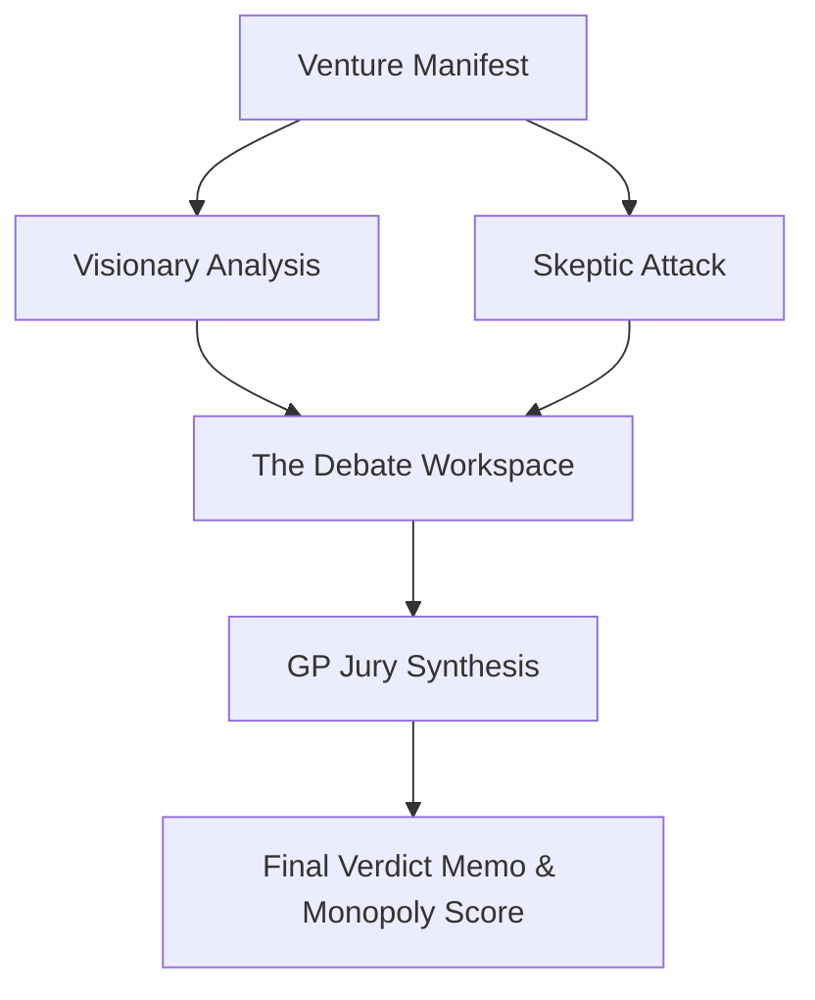

# Adversarial Agent Logic: The Venture Jury

MonopolyMap moves beyond simple prompting into a structured adversarial debate. The "Venture Jury" flow ensures that every idea is stress-tested before receiving a final verdict.

## The Specialist Agents

### The Visionary Specialist (Optimistic / 10x)
*   **Persona**: Peter Thiel / Marc Andreessen.
*   **Role**: Seeks the breakthrough. If the idea has 10x potential, the Visionary will defend it against the Skeptic.
*   **Success Metric**: Identifying the "Secret" and the compounding effects.

### The Skeptic Specialist (Adversarial / 1 to N)
*   **Persona**: Ruthless Institutional VC / Short-Seller.
*   **Role**: Attacks the thesis. Looks for "hidden incumbents," "timing traps," and "incrementalism."
*   **Success Metric**: Finding fatal flaws that the founder is ignoring.

## The GP Jury (The Harmonizer)

The GP Jury is the final arbiter. They do not analyze the raw idea; they analyze the **debate** between the Visionary and the Skeptic.

### Interaction Flow

### The Verdict Memo
The GP Jury generates a professional "Verdict Memo" (similar to a Sequoia Investment Memo) that includes:
1.  **Investment Thesis**: The synthesized value proposition.
2.  **The Debate Summary**: Key points of contention between Visionary and Skeptic.
3.  **The Monopoly Score**: A weighted calculation of the idea's 0-to-1 potential.
4.  **Actionable Feedback**: What the founder must change to hit a 10x outcome.
